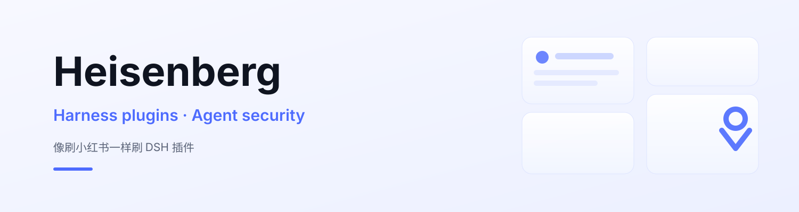

  <picture>
    <source media="(prefers-color-scheme: dark)" srcset="./assets/banner-dark.svg">
    
  </picture>

### 你好，我是 Heisenberg

做两件事：**DSH 插件开发**，和 **Agent 安全**。
插件让 agent 更能干；安全让这件事可持续。

#### Building · Harness 插件

**逛逛 · dsh-feed-market**（即将开源）
像刷小红书一样刷 DSH 插件：双列瀑布流、兴趣推荐、一键安装。

| 项目 | 一句话 |
|---|---|
| [hades-trace-analyzer](https://github.com/alexfly123lee-creator/hades-trace-analyzer) | DSH 会话 trace 分析，定位 run/step 卡点 |
| [Claude-Code-Cheer](https://github.com/alexfly123lee-creator/Claude-Code-Cheer) | Claude Code 状态栏伙伴 |

#### Securing · Agent 安全

| 项目 | 一句话 |
|---|---|
| [know-your-skill](https://github.com/alexfly123lee-creator/know-your-skill) | 加载前先看清：扫描并管理本地 skill |
| Agent Security Notes（准备中） | DSH 插件权限、工具调用、供应链的检查清单 |

> 做插件的人很多，愿意把“插件可能怎么出事”写清楚的人不多。

#### Stack

`TypeScript` · `Python` · `React` · `Node` · `Cordis`

#### Contact

[GitHub](https://github.com/alexfly123lee-creator) · [Email](mailto:alexfly123.lee@gmail.com)
